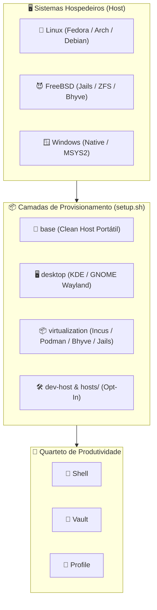

# 📦 Universal Setup Environment

> Repositório público de provisionamento de sistema operacional, receitas atômicas de infraestrutura, drivers de hardware, containers e estações de trabalho limpas (_Clean Host_). Componente de sistema do **Quarteto de Produtividade**.

---

### 🏛️ O Quarteto de Produtividade

[](https://github.com/GabrielFrigo4/setup)
[](https://github.com/GabrielFrigo4/shell)
[](https://github.com/GabrielFrigo4/vault)
[](https://github.com/GabrielFrigo4/profile)

> 📖 **Arquitetura Unificada do Ecossistema:** Conheça a matriz completa de responsabilidades, ciclo de boot e segregação de privilégios em [ENVIRONMENT.md](ENVIRONMENT.md).
> 📜 **Princípios de Engenharia & Infraestrutura:** Conheça os 22 princípios de engenharia UNIX + Clean Code em [PRINCIPLES.md](PRINCIPLES.md).
> 🗺️ **Roadmap & Status do Projeto:** Acompanhe o planejamento e a matriz de status em [TODO.md](TODO.md).
> 🤝 **Guia de Contribuição & Setup:** Instruções de bancada, ganchos Git e quality gates em [CONTRIBUTING.md](CONTRIBUTING.md).

---

### 🖥️ Sistemas Operacionais Suportados


-Supported-purple?logo=gitforwindows&logoColor=white>)
[](TODO.md)
[](CONTRIBUTING.md)

### 🎨 Interfaces Gráficas & Tecnologias Host




---

## 🧠 Filosofia: Clone Soberano, Clean Host e Separação `hosts/`

O **Setup** provê a fundação do sistema operacional com privilégios administrativos (`root` / `doas` / `sudo` / Admin):

1. **Clone Soberano (`bootstrap.sh`):** Em 1 linha (`curl -fsSL ... | sh`), o bootstrap clona ou atualiza o repositório em `~/.local/share/setup` (`$SETUP_DIR`), aplica permissões canônicas (`0755`) e dispara o orquestrador local [`setup.sh`](setup.sh) com todos os módulos `core/` disponíveis offline.
2. **Clean Host:** O sistema nativo permanece enxuto e portátil, provendo base de sistema, drivers, interface gráfica e camada de virtualização/containers (`Incus`, `Podman`, `Jails`, `Bhyve`). Ferramentas de desenvolvimento pesadas no host são opt-in via `--profile=dev-host`.
3. **Isolamento de Hardware (`hosts/`):** Quirks físicos específicos de máquinas pessoais (ex: `hosts/vostro3520-freebsd.sh`) vivem segregados em [`hosts/`](hosts/README.md) sob execução opt-in (`--profile=host`), mantendo `freebsd/` e `linux/` 100% portáteis.
4. **Idempotência Rigorosa:** Toda receita pode ser executada múltiplas vezes produzindo o mesmo estado estável.

---

## 📂 Estrutura do Projeto

- **[`bootstrap.sh`](bootstrap.sh)** — **Bootstrap Soberano:** Clona/atualiza o repositório em `~/.local/share/setup` e executa `setup.sh`.
- **[`setup.sh`](setup.sh)** — **Orquestrador em Camadas:** Executa perfis (`base`, `desktop`, `virtualization`, `dev-host`, `host`, `server`), além de `doctor`, `audit` e `test`.
- **[`core/`](core/README.md)** — **Biblioteca de Fundação:** Detecção de plataforma (`detect.sh`), elevação (`elevate.sh`), pacotes (`pkg.sh`), permissões (`perms.sh`) e interface TUI (`ui.sh`).
- **[`hosts/`](hosts/README.md)** — **Perfis de Hardware Opt-In:** Quirks específicos por máquina física (`vostro3520-freebsd.sh`).
- **[`common/`](common/README.md)** — **Receitas Multiplataforma:** CLI, editores, fontes, gráficos/shaders, Python, linters, escritório, ISOs e segurança.
- **[`freebsd/`](freebsd/README.md)** — **FreeBSD Nativo:** Tunables de kernel (`common/`), Jails/Bastille/Bhyve/Podman (`container/`), KDE Plasma 6 (`desktop/`) e guest KVM (`server/`).
- **[`linux/`](linux/README.md)** — **Distribuições Linux:** Workstations Fedora, Arch e Debian (`desktop/`), base multi-distro (`common/`), containers (`container/`), WSL2 (`wsl/`) e servidor (`server/`).
- **[`windows/`](windows/README.md)** — **Windows & MSYS2:** Winget declarativo (`winget.json`), Scoop, registro/Hyper-V (`native/`) e receitas UCRT64 (`msys2/`).
- **[`.scripts/`](.scripts/README.md)** — Utilitários de compilação local (`build/`), diagnóstico (`doctor.sh`) e auditoria estática (`audit/`).
- **[`docs/`](docs/README.md)** — Documentação técnica e arquitetural (`ARCHITECTURE.md`, `BOOTSTRAP.md`, `BSD.md`, `LINUX.md`, `WINDOWS.md`, `VAULT.md`).

---

## 🚀 Bootstrap & Execução (Clone Soberano)

Instalação ou atualização completa via bootstrap de 1 linha:

```sh
curl -fsSL https://raw.githubusercontent.com/GabrielFrigo4/setup/main/bootstrap.sh | sh -s -- --profile=base
```

Execução direta a partir do clone local (`~/.local/share/setup`):

```sh
sh "${XDG_DATA_HOME:-${HOME}/.local/share}/setup/setup.sh" --profile=base
sh "${XDG_DATA_HOME:-${HOME}/.local/share}/setup/setup.sh" --profile=desktop
sh "${XDG_DATA_HOME:-${HOME}/.local/share}/setup/setup.sh" --profile=virtualization
sh "${XDG_DATA_HOME:-${HOME}/.local/share}/setup/setup.sh" --profile=dev-host
sh "${XDG_DATA_HOME:-${HOME}/.local/share}/setup/setup.sh" --profile=host
sh "${XDG_DATA_HOME:-${HOME}/.local/share}/setup/setup.sh" doctor
```

---

## 🚀 Setup do Projeto & Ganchos Git

Para configurar a bancada de desenvolvimento local, ativar os quality gates e validar a integridade do repositório:

```sh
make hooks
make test
make audit
make ci
```

> 🤝 **Instruções Detalhadas:** Consulte o [CONTRIBUTING.md](CONTRIBUTING.md) para convenções de commits, invariantes de engenharia, regras de idempotência e diretrizes de desenvolvimento.

---

## 🔗 Integração com o Quarteto de Produtividade

Após provisionar a máquina hospedeira com o **Setup**:

1. Instale o motor interativo de terminal com o **[Shell](https://github.com/GabrielFrigo4/shell)**.
2. Clone seu cofre de credenciais e chaves criptográficas em `~/.local/share/vault` com o **[Vault](https://github.com/GabrielFrigo4/vault)**.
3. Clone e sincronize seus dotfiles e skills de IA com o **[Profile](https://github.com/GabrielFrigo4/profile)**.
