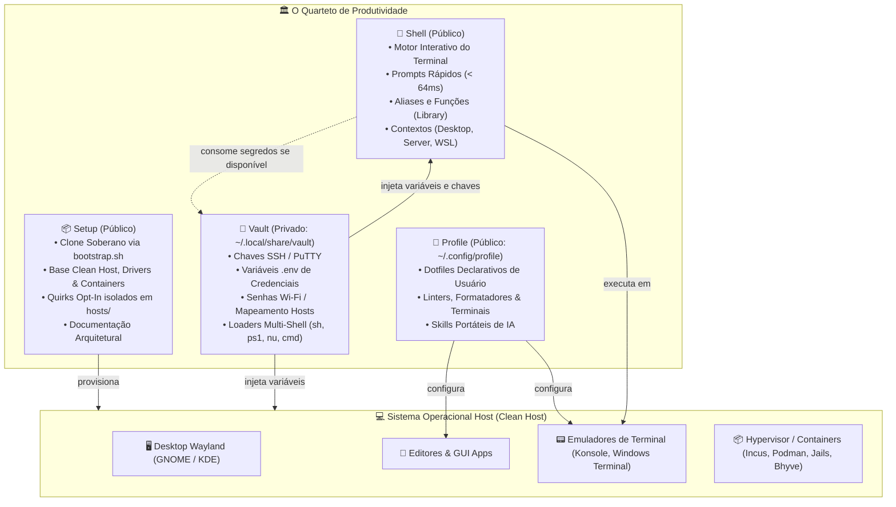

# 🏛️ A Arquitetura do Quarteto de Produtividade

Este documento formaliza a arquitetura e as fronteiras de responsabilidade entre os 4 repositórios centrais que compõem o ambiente de trabalho e desenvolvimento unificado (acompanhados pela **Suíte de Editores** em `Emacs`, `Helix`, `NeoVim` e `Vim`).

---

## 🎯 A Divisão de Responsabilidades

---

## 📋 Matriz de Responsabilidades

| Aspecto                 | `Setup`                                                                 | `Shell`                                            | `Vault`                                             | `Profile`                                       |
| :---------------------- | :---------------------------------------------------------------------- | :------------------------------------------------- | :-------------------------------------------------- | :---------------------------------------------- |
| **Visibilidade**        | Público (GitHub)                                                        | Público (GitHub)                                   | **Privado** (GitHub/Local)                          | Público (GitHub)                                |
| **Natureza**            | Provisionamento de SO, Drivers, Containers e Quirks `hosts/`            | Motor Dinâmico (Runtime e Linha de Comando)        | Dados Sensíveis e Loaders Multi-Shell               | Dotfiles declarativos de usuário e skills de IA |
| **Local de Instalação** | `~/.local/share/setup` (Clone Soberano via `bootstrap.sh`)              | `/usr/local/share/shell` ou `~/.local/share/shell` | `~/.local/share/vault` (XDG Data)                   | `~/.config/profile` ou `~/.local/share/profile` |
| **Público-Alvo**        | Provisionamento idempotente de sistema                                  | Nova sessão aberta de terminal                     | Injeção silenciosa de credenciais                   | Sincronização de dotfiles e editores no `$HOME` |
| **Tolerância a Falhas** | Receitas idempotentes com detecção via `core/detect.sh` e `core/pkg.sh` | Degrada graciosamente sem o Vault                  | Audita permissões (`0600`/`0700`) via `vault-perms` | Symlinks declarativos com auto-cura             |

---

## 🔄 Fluxo de Boot e Integração

1. **Provisionamento do SO via Clone Soberano (`Setup`):**
    - O usuário executa `curl -fsSL https://raw.githubusercontent.com/GabrielFrigo4/setup/main/bootstrap.sh | sh -s -- --profile=base` (ou desktop/virtualization/host).
    - O bootstrap clona `Setup` em `~/.local/share/setup` e executa `setup.sh` localmente com todos os módulos em `core/`.
    - O sistema recebe base portátil, ZFS, interface gráfica Wayland e camada de containers/hypervisors.
2. **Clonagem dos Repositórios Residentes (`Shell`, `Vault`, `Profile`):**
    - O **Shell** é clonado em `/usr/local/share/shell` e instalado via `sh install.sh --context desktop`.
    - O **Vault** é clonado em `~/.local/share/vault` e protegido com permissões `0700`/`0600`.
    - O **Profile** é clonado em `~/.config/profile` e sincroniza dotfiles, formatadores e skills de IA.
3. **Sessão de Terminal Interativa:**
    - O terminal carrega `Shell/core/environment.sh`, que resolve dinamicamente o Vault (`~/.local/share/vault/vault.sh`), exporta chaves/variáveis em silêncio e renderiza o prompt em menos de 64ms.
